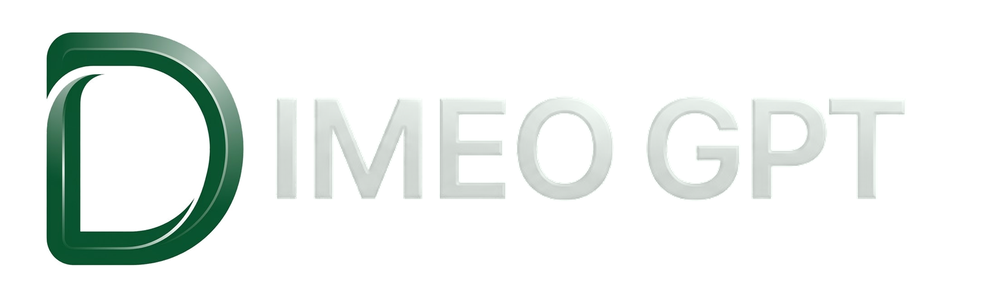
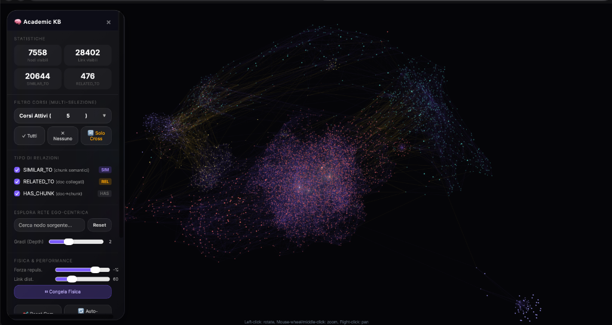
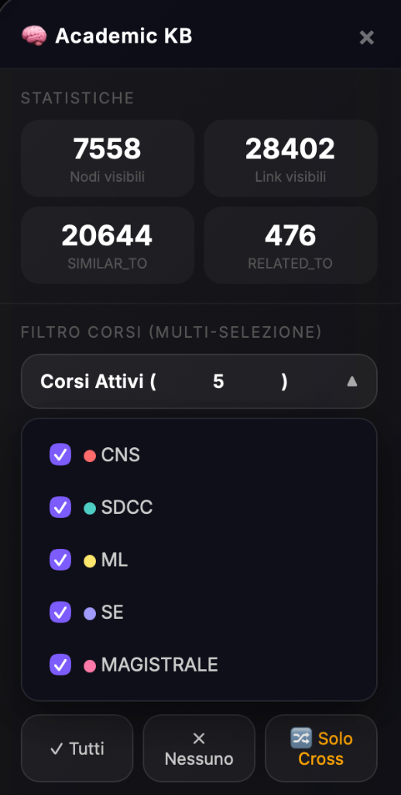
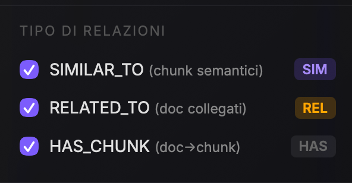
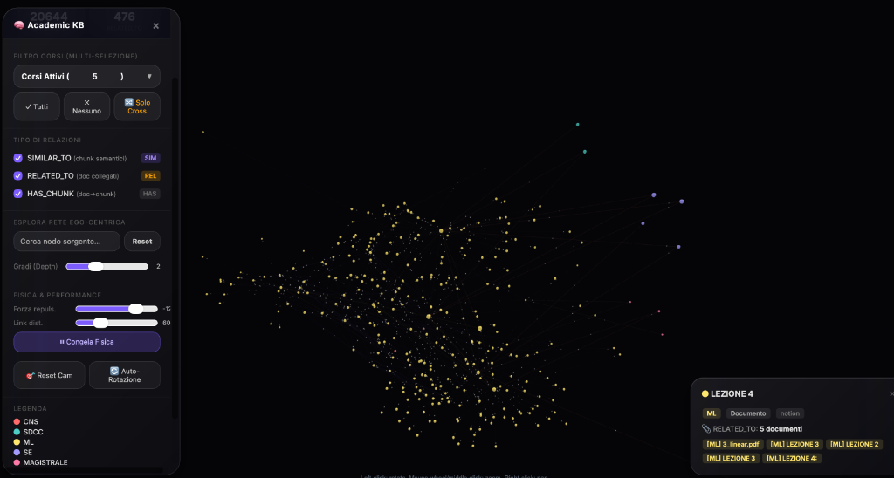
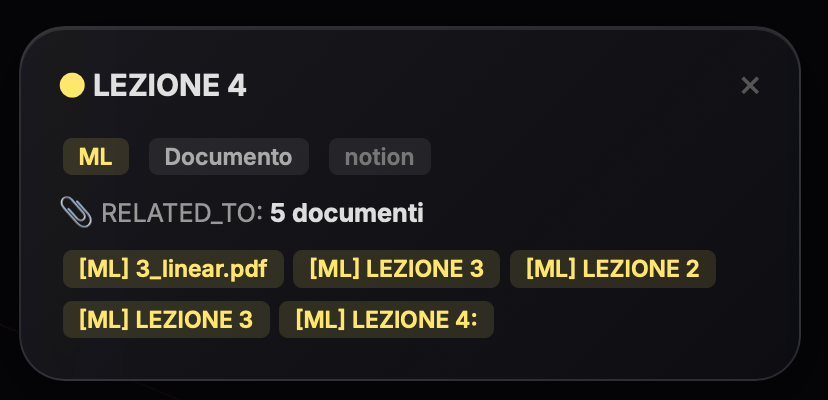
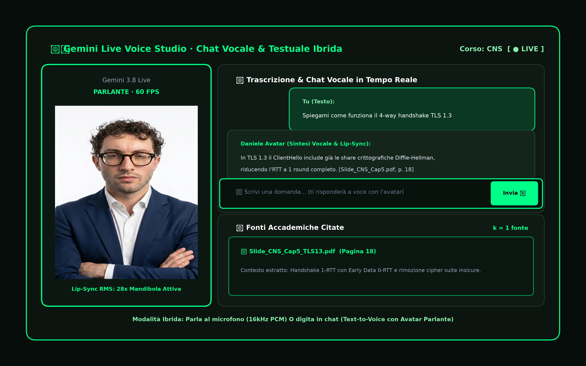
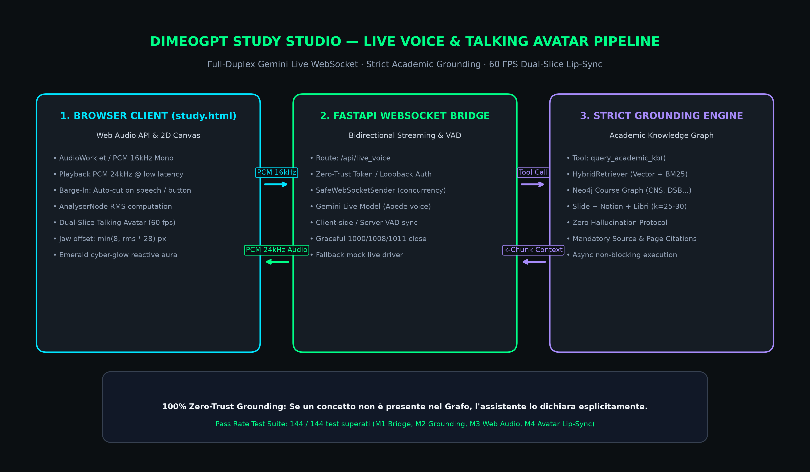
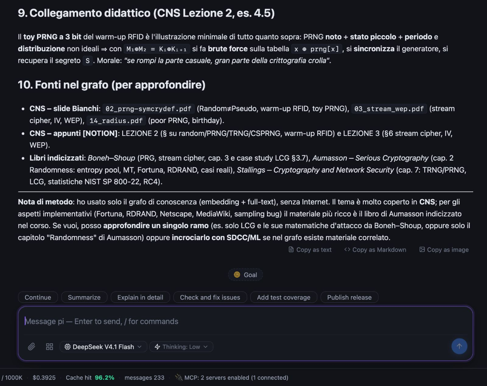

# 🧠 Academic KB — 3D Semantic Knowledge Graph, Study Studio & Voice Assistant

<p align="center">
  
</p>

<p align="center">
  
  
  
  
  
  
  
</p>

**Academic KB** è una piattaforma unificata per la gestione, l'apprendimento e il retrieval semantico di materiali universitari della Laurea Magistrale in Ingegneria Informatica (Cybersecurity, Sistemi Distribuiti e Cloud Computing, Machine Learning, Ingegneria del Software, ecc.).

Il sistema aggrega slide accademiche, dispense, libri di testo, paper scientifici e appunti digitali Notion all'interno di un **Knowledge Graph semantico vettorializzato su Neo4j**. Offre un visualizzatore 3D WebGL con animazioni cinematiche, una suite di studio avanzata (**Study Studio**) con quiz e flashcard SM-2, un assistente vocale bidirezionale in streaming a bassa latenza basato su **Gemini Live API** e un server **FastMCP** per l'interrogazione da parte di agenti AI.

---

## 📸 Galleria Interfaccia & Funzionalità

### 1. Visualizzatore 3D a Costellazione (`graph_3d.html`)
L'interfaccia 3D adotta un'estetica **Apple Liquid Glass** con un HUD semitrasparente e non invasivo, visualizzando decine di migliaia di nodi concettuali e relazioni semantiche nello spazio tridimensionale.

<p align="center">
  
</p>

* **HUD Statistiche in Tempo Reale**: Monitora istantaneamente il numero di nodi visibili, link attivi e la distribuzione tra link semantici (`SIMILAR_TO`) e macro-relazioni tra documenti (`RELATED_TO`).
* **Flusso di Particelle Dinamico**: Pacchetti luminosi viaggiano lungo gli archi per visualizzare i ponti semantici e le connessioni interdisciplinari.
* **Modelli 3D Interattivi**: Integrazione nel grafo dell'aereo da addestramento avanzato **Aermacchi M-345 Frecce Tricolori** (con scie fumogene tricolori e caschi blu) e della **Tesla Roadster**, navigabili liberamente nello spazio orbitale.

---

### 2. Filtro Corsi & Isolamento Interdisciplinare ("Solo Cross")
La barra laterale permette di isolare specifici corsi di laurea magistrale con codifica a colori nativa:

<p align="center">
  
</p>

* **Filtro Multiplo**: Attiva o disattiva istantaneamente le materie (**CNS**, **SDCC**, **ML**, **SE**, **MAGISTRALE**).
* **Pulsante `🔀 Solo Cross`**: Isola in un clic unicamente i nodi e i concetti ponte tra corsi differenti (ad es. applicazioni di *Machine Learning* per l'analisi di anomalie in *Cybersecurity* o protocolli di consenso distribuiti in *Sistemi Cloud*).

---

### 3. Ontologia Semantica del Grafo
Il grafo modella tre livelli distinti di connessione, filtrabili tramite gli interruttori dedicati dell'HUD:

<p align="center">
  
</p>

| Relazione | Livello | Descrizione |
| :--- | :--- | :--- |
| **`SIMILAR_TO`** | *Chunk Semantici* | Collega frammenti di testo appartenenti a documenti diversi la cui *cosine similarity* supera la soglia (default `0.82`). Rappresenta concetti affini o condivisi tra lezioni diverse. |
| **`RELATED_TO`** | *Documenti Interi* | Macro-relazione tra interi documenti che condividono cluster significativi di chunk simili (minimo 3). |
| **`HAS_CHUNK`** | *Strutturale* | Connette gerarchicamente ciascun documento (file PDF o pagina Notion) ai rispettivi frammenti vettorializzati. |

---

### 4. Esplorazione Focus & Scheda Dettaglio Documento
Cliccando su un qualsiasi nodo del grafo, la telecamera Three.js esegue uno zoom fluido centrando l'elemento e aprendo una scheda di dettaglio con metadati e correlazioni:

<p align="center">
  
</p>

<p align="center">
  
</p>

---

### 5. Study Studio & DIMEOGPT (`study.html`)
Una dashboard interattiva pensata per la preparazione intensiva degli esami universitari:

* **Generatore Quiz Multimodale**: Quiz a risposta multipla a 4 opzioni e domande aperte generate dinamicamente estraendo chunk reali dal database Neo4j.
* **Rendering Matematico KaTeX**: Formule crittografiche, equazioni differenziali, matrici e funzioni di costo renderizzate in LaTeX in tempo reale.
* **Banca Errori & Spiegazione Rigorosa**: Registrazione automatica delle risposte errate con possibilità di richiedere all'LLM l'analisi dettagliata del ragionamento fallace.
* **Flashcard con Algoritmo SuperMemo-2 (SM-2)**: Ripetizione spaziata intelligente basata sulla difficoltà di richiamo (`Facile`, `Buono`, `Difficile`, `Ripeti`).
* **Learning Path & Gap Detector**: Individuazione proattiva dei concetti mancanti (lacune) e generazione di un percorso sequenziale con prerequisiti.

---

### 6. Gemini Live Voice Studio (`engine/voice/`)
Un assistente vocale conversazionale real-time collegato direttamente al Knowledge Graph:

<p align="center">
  
</p>

<p align="center">
  
</p>

* **Streaming Bidirezionale a Bassa Latenza**: Connessione WebSocket persistente con Gemini Live API (`gemini-3.8-live`).
* **Interruzione Fluida (Barge-In)**: Interrompi l'assistente vocale in qualsiasi istante parlando al microfono; il sistema silenzia la riproduzione in millisecondi.
* **Accoppiamento Accademico (Grounding)**: Prima di rispondere, il modulo inietta nel contesto vocale i frammenti precisi estratti dalle dispense e dai libri di testo del corso.
* **Avatar & Visualizer Audio**: Indicatore visivo delle onde sonore dell'utente e dell'assistente con fallback grafico DOM/Canvas reattivo.

---

### 7. Retrieval MCP con Prompt Caching (96.2% Hit Rate)
Grazie al server **FastMCP** (`mcp_server/server.py`), qualsiasi assistente AI (Claude Desktop, Antigravity, Cursor, DeepSeek) interroga la base di conoscenza tramite **Retrieval Ibrido** (Embedding Vettoriali + BM25 Full-Text Cypher) in locale:

<p align="center">
  
</p>

---

## 📁 Organizzazione delle Cartelle & Sistema Source Tier

Per consentire l'indicizzazione automatica corretta, i documenti devono essere strutturati seguendo la logica delle cartelle dei corsi universitari.

Il motore applica un **algoritmo euristico a 3 livelli di priorità (`Source Tier`)**, fondamentale affinché l'LLM dia la precedenza alle slide spiegate dal docente rispetto a interi capitoli enciclopedici:

```
📁 MAGISTRALE/Corsi/                  <-- [MAGISTRALE_COURSES_DIR]
├── 📁 CNS/                          <-- Nome del corso (Computer Network Security)
│   ├── 01_intro_security.pdf        <-- [Tier: primary  ⭐⭐⭐] Slide e dispense ufficiali
│   ├── 02_prng_stream_ciphers.pdf   <-- [Tier: primary  ⭐⭐⭐]
│   └── 📁 CNS resources/            <-- Cartella risorse extra per il corso
│       ├── book - Serious Crypto.pdf<-- [Tier: resource ⭐⭐] Libri (prefisso "book -")
│       └── 📁 articles/             <-- [Tier: article  ⭐] Paper scientifici e articoli
│           └── length_extension.pdf
│
├── 📁 SDCC/                         <-- Sistemi Distribuiti e Cloud Computing
│   ├── 01_architetture_cloud.pdf    <-- [Tier: primary  ⭐⭐⭐]
│   ├── 02_consenso_raft_paxos.pdf   <-- [Tier: primary  ⭐⭐⭐]
│   └── 📁 resources/
│       ├── book - Distr Systems.pdf <-- [Tier: resource ⭐⭐]
│       └── 📁 papers/
│           └── spanner_google.pdf   <-- [Tier: article  ⭐]
│
├── 📁 ML/                           <-- Machine Learning
│   ├── 01_regressione_lineare.pdf   <-- [Tier: primary  ⭐⭐⭐]
│   └── 02_support_vector_mach.pdf   <-- [Tier: primary  ⭐⭐⭐]
│
└── 📁 SE/                           <-- Software Engineering
    └── 01_microservices_ddd.pdf     <-- [Tier: primary  ⭐⭐⭐]
```

### Regole del Riconoscimento Automatico:
1. **Corso**: Derivato automaticamente dal nome della cartella principale (es. `CNS`, `SDCC`, `ML`, `SE`).
2. **`primary` (⭐⭐⭐ - Priorità Massima)**: Tutti i PDF posizionati nella root del corso e tutte le pagine sincronizzate da **Notion**. Rappresentano la spiegazione data a lezione.
3. **`resource` (⭐⭐ - Priorità Media)**: Tutti i PDF contenuti in una cartella `resources` il cui nome comincia con `book -` o `book-`.
4. **`article` (⭐ - Priorità Bassa)**: Tutti i PDF posizionati dentro sottocartelle `articles/`, `papers/` o `articoli/`, oppure documenti generici dentro `resources/` che non sono contrassegnati come libri.

---

## 🛠️ Guida di Configurazione Approfondita

Segui questi passaggi per configurare l'intero stack da zero.

### Fase 1: Prerequisiti
* **macOS / Linux / Windows WSL2**
* **Python 3.11, 3.12 o 3.13**
* **Neo4j 5.x** (nativamente con Homebrew oppure via Docker)
* **API Key** (a scelta tra Google Gemini, OpenAI, DeepSeek o modello locale Ollama)

---

### Fase 2: Configurazione del Database Neo4j

#### Opzione A — Installazione Nativa macOS (Consigliata per Mac Apple Silicon)
```bash
# 1. Installa Neo4j tramite Homebrew
brew install neo4j

# 2. Imposta la password iniziale per l'utente 'neo4j'
neo4j-admin dbms set-initial-password YOUR_PASSWORD_HERE

# 3. Avvia il servizio
brew services start neo4j

# (Quando vorrai fermarlo per risparmiare risorse: brew services stop neo4j)
```

#### Opzione B — Esecuzione con Docker Compose
Se preferisci isolare il database in un container:
```bash
# Avvia il container in background
docker compose up -d

# Per verificare che il container sia attivo e funzionante:
docker compose ps
```

Accedi all'interfaccia web di gestione Neo4j su [http://localhost:7474](http://localhost:7474) con utente `neo4j` e la password appena scelta.

---

### Fase 3: Ambiente Virtuale & File `.env`

1. **Clona il repository**:
   ```bash
   git clone https://github.com/danydim03/academic-kb-public.git
   cd academic-kb-public
   ```

2. **Crea e attiva un virtual environment Python**:
   ```bash
   python3 -m venv .venv
   source .venv/bin/activate
   # Su Windows: .venv\Scripts\activate
   ```

3. **Installa le dipendenze**:
   ```bash
   pip install --upgrade pip
   pip install -e .
   ```

4. **Configura le variabili d'ambiente**:
   Copia il template `.env.example`:
   ```bash
   cp .env.example .env
   ```

   Modifica `.env` con il tuo editor di testo:
   ```ini
   # ----------------------------------------------------
   # DATABASE NEO4J
   # ----------------------------------------------------
   NEO4J_URI=bolt://localhost:7687
   NEO4J_USERNAME=neo4j
   NEO4J_PASSWORD=YOUR_PASSWORD_HERE

   # ----------------------------------------------------
   # PERCORSO CORSI UNIVERSITARI
   # ----------------------------------------------------
   MAGISTRALE_COURSES_DIR=/Users/tuonome/Documents/Universita/Corsi

   # ----------------------------------------------------
   # EMBEDDINGS (VETTORIZZAZIONE)
   # Provider disponibili: "gemini", "openai", "ollama", "mock"
   # ----------------------------------------------------
   EMBEDDING_PROVIDER=gemini
   EMBEDDING_MODEL=text-embedding-004
   EMBEDDING_DIMENSION=768
   EMBEDDING_API_KEY=la_tua_gemini_api_key

   # ----------------------------------------------------
   # MODELLO LLM (STUDY STUDIO & QUIZ)
   # Provider: "gemini", "openai", "deepseek", "ollama", "mock"
   # ----------------------------------------------------
   LLM_PROVIDER=gemini
   LLM_MODEL=gemini-2.0-flash
   LLM_API_KEY=la_tua_gemini_api_key

   # ----------------------------------------------------
   # GEMINI LIVE VOICE ASSISTANT
   # ----------------------------------------------------
   GEMINI_API_KEY=la_tua_gemini_api_key
   GEMINI_LIVE_VOICE=Charon        # Voci: Charon, Puck, Fenrir, Aoede
   GEMINI_LIVE_MODEL=gemini-3.8-live

   # ----------------------------------------------------
   # NOTION (OPZIONALE - Per appunti digitali)
   # ----------------------------------------------------
   NOTION_API_KEY=ntn_tua_notion_integration_token
   NOTION_ROOT_DATABASE_ID=id_del_database_notion_condiviso

   # ----------------------------------------------------
   # AUTENTICAZIONE WEB API
   # ----------------------------------------------------
   ACADEMIC_KB_TOKEN=dev-token-academic-kb
   LOG_LEVEL=INFO
   ```

---

### Fase 4: Esecuzione della Pipeline di Indicizzazione

Una volta configurato `.env` e posizionati i file nelle cartelle:

1. **Sincronizzazione Automatica Corsi (PDF + Notion)**:
   ```bash
   python scripts/sync_magistrale.py
   ```
   Lo script:
   - Scansiona ricorsivamente tutte le sottocartelle dei corsi.
   - Calcola il checksum SHA-256 incrementale: analizza solo i file nuovi o modificati.
   - Esegue il chunking semantico (1000 caratteri con 200 di overlap).
   - Genera gli embedding vettoriali e li indicizza in Neo4j.
   - Pulisce automaticamente dal database eventuali file rimossi o rinominati dal disco (`auto-prune`).
   - Se configurate le credenziali Notion, scarica e indicizza gli appunti associandoli ai corsi.

2. **Costruzione dei Collegamenti Semantici (`SIMILAR_TO` & `RELATED_TO`)**:
   ```bash
   python scripts/build_semantic_links.py
   ```
   Confronta la similarità coseno tra tutti i chunk dei diversi documenti e genera gli archi della rete di conoscenza.

3. **Verifica dello Stato del Grafo**:
   ```bash
   python scripts/status.py
   ```
   Mostra la distribuzione di nodi, documenti e relazioni creati.

4. **Esportazione Dataset 3D per Visualizzazione Offline**:
   ```bash
   python scripts/export_json.py
   ```
   Genera il file `graph_3d_data.json` pronto per il rendering WebGL.

---

### Fase 5: Avvio dell'Applicazione

Puoi utilizzare l'applicazione in tre modalità distinte a seconda delle tue esigenze:

#### 🟢 Modalità 1: Full-Stack FastAPI (Consigliata)
Avvia sia il server REST, il server WebSocket per l'assistente vocale, sia l'hosting delle pagine web:
```bash
python run_api.py --port 8000
```
Oppure tramite lo script macOS dedicato:
```bash
./Start_Server.command
```
Apri il browser su:
* **Dashboard Hub Principale**: [http://localhost:8000/index.html](http://localhost:8000/index.html)
* **Study Studio & DIMEOGPT**: [http://localhost:8000/study.html](http://localhost:8000/study.html)
* **Visualizzatore 3D Knowledge Graph**: [http://localhost:8000/graph_3d.html](http://localhost:8000/graph_3d.html)
* **Documentazione Swagger API**: [http://localhost:8000/docs](http://localhost:8000/docs)

#### 🔵 Modalità 2: Standalone 3D Viewer (Zero-Config / Mock Mode)
Se desideri semplicemente esplorare il grafo 3D senza avviare Neo4j o FastAPI:
```bash
python3 -m http.server 8000
```
Visita [http://localhost:8000/graph_3d.html](http://localhost:8000/graph_3d.html).

#### 🟣 Modalità 3: Server FastMCP per Assistenti AI (Claude / Antigravity / Cursor)
Puoi connettere il tuo assistente AI direttamente al Knowledge Graph aggiungendo il server MCP alla configurazione del client (es. `claude_desktop_config.json`):

```json
{
  "mcpServers": {
    "academic-kb": {
      "command": "/percorso/academic-kb-public/.venv/bin/python",
      "args": ["/percorso/academic-kb-public/mcp_server/server.py"],
      "env": {
        "NEO4J_URI": "bolt://localhost:7687",
        "NEO4J_USERNAME": "neo4j",
        "NEO4J_PASSWORD": "YOUR_PASSWORD_HERE",
        "EMBEDDING_PROVIDER": "gemini",
        "GEMINI_API_KEY": "la_tua_api_key"
      }
    }
  }
}
```

---

## 🧪 Validazione & Test Suite

Il progetto include una suite completa di test unitari, di integrazione e di robustezza avversariale.

Per eseguire l'intera suite dei test vocali e di streaming:
```bash
pytest tests/voice/ -v
```

Risultato atteso:
```
======================== 159 passed in 9.44s ========================
```

---

## 🏛️ Stack Tecnologico

* **Frontend 3D**: [Three.js](https://threejs.org/), [3d-force-graph](https://github.com/vasturiano/3d-force-graph), WebGL, Shaders GLSL personalizzati.
* **UI & Styling**: CSS3 Apple Liquid Glass Design (`backdrop-filter: blur`, transizioni cubiche `cubic-bezier`, tipografia Inter).
* **Backend**: [FastAPI](https://fastapi.tiangolo.com/), Uvicorn, WebSockets.
* **Database a Grafo**: [Neo4j 5](https://neo4j.com/) con Vector Indexing HNSW e Cypher.
* **Motore Vocale**: Google Gemini Live API (`gemini-3.8-live`) con streaming bidirezionale PCM 16-bit e VAD.
* **NLP & Embeddings**: Google GenAI SDK (`text-embedding-004`), OpenAI, Ollama.
* **Protocollo Agenti**: FastMCP (Model Context Protocol).
* **Formule Matematiche**: [KaTeX](https://katex.org/) bundle locale offline.

---

## 🔒 Sicurezza & Privacy

* **Nessun Dato Personale**: Il codice è stato completamente sanitizzato per l'uso pubblico; nessuna foto, credenziale, percorso assoluto o informazione riservata è inclusa nel repository.
* **Elaborazione Locale**: Il database Neo4j e i file sorgente risiedono sul tuo computer.
* **Token di Autenticazione**: Le chiamate verso gli endpoint REST e WebSocket sono protette dal token configurabile tramite `ACADEMIC_KB_TOKEN` (default: `dev-token-academic-kb`).
